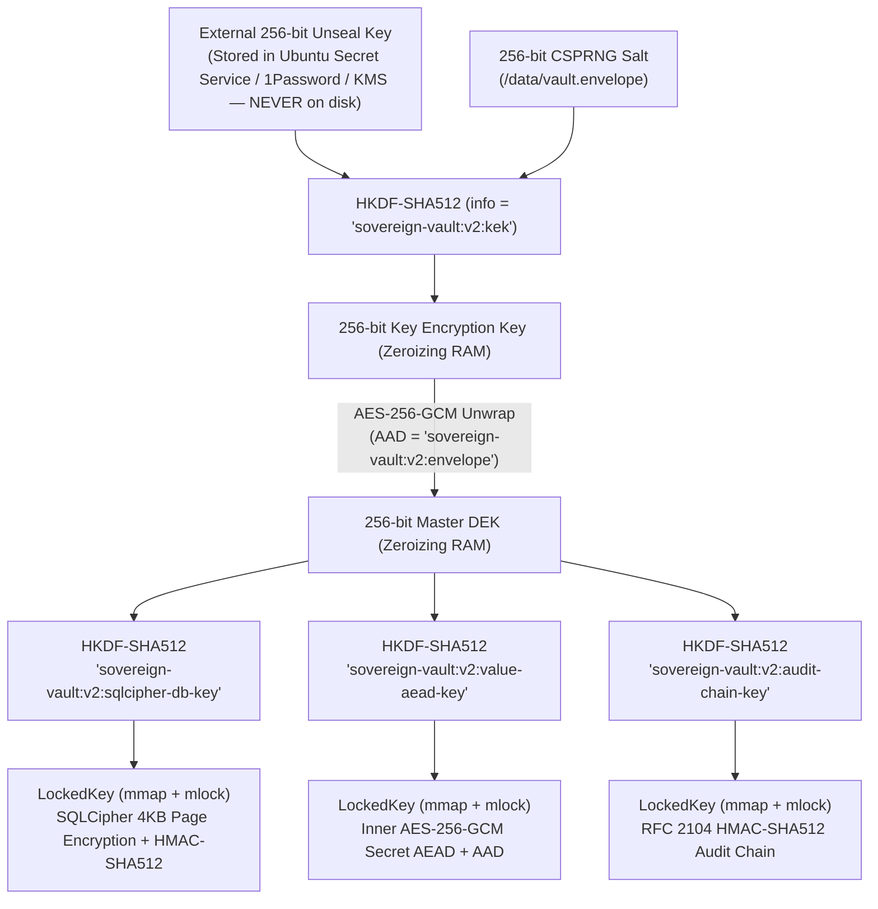

# Sovereign Vault v1.0 — Cryptographic & Runtime Architecture

**Version**: `1.0.0`  
**Architecture Spec**: SPEC-014 (Micro-KMS Architecture), ADR-0008 (Zero-Trust BYOC & Hardware Enclaves)

---

## 1. End-to-End Cryptographic Hierarchy

Sovereign Vault separates **key wrapping**, **database page encryption**, **per-value authenticated encryption**, and **tamper-evident audit chaining** into domain-separated keys derived from a single 256-bit Master Data Encryption Key (`master_dek`):

---

## 2. Request Processing & Defense-in-Depth Lifecycle

### 2.1 First-Boot Initialization (`POST /v1/sys/init`)
1. On first boot (no `/data/vault.envelope`), the daemon generates a 256-bit single-use bootstrap nonce (`init_<64hex>`) held strictly in `Zeroizing<String>` RAM.
2. `init_handler` verifies `X-Vault-Bootstrap-Nonce` in constant time (`constant_time_str_eq`) under a sliding-window rate limiter, immediately burning the nonce upon match.
3. Generates `unseal_key` ($32\text{ B}$) and `master_dek` ($32\text{ B}$), wraps `master_dek` into `/data/vault.envelope` (`0600`), opens `/data/vault.db` (`0600`) under 256-bit SQLCipher (`PBKDF2_HMAC_SHA512`, `HMAC_SHA512`, `PRAGMA synchronous = FULL`), mints the initial root admin token (`SHA-512` hashed at rest), records genesis event `sys.init` in `audit_log`, and returns `(unseal_key, admin_token)` once.

### 2.2 Seal & Verified Unseal (`POST /v1/sys/seal`, `POST /v1/sys/unseal`)
- **Seal**: Requires `admin` capability, records `sys.seal` in the hash-chained `audit_log`, and sets `AppState.active = None`—closing SQLCipher and triggering `Drop` on every `LockedKey` (`zeroize` -> `munlock` -> `munmap`).
- **Unseal**: Rejects with `409 Conflict` if already unsealed (preventing live key clobbering). Verifies the `AES-256-GCM` tag on `/data/vault.envelope` **before** opening SQLCipher or mutating runtime state (`401 Unauthorized` + rate-limit accounting on invalid key).

### 2.3 Machine Token Authentication & Canonical ACLs (`/v1/secret/*`, `/v1/secrets`)
1. `authenticate_caller` enforces default-deny bearer extraction (`X-Vault-Token` or `Authorization: Bearer`), splits `sv_live_<32hex_id>_<64hex_secret>`, looks up `tok_<32hex_id>` in SQLCipher, verifies `SHA-512(secret)` in constant time (`subtle::ConstantTimeEq`), and enforces `expires_at` TTLs.
2. `canonicalize_secret_path` rejects `.`, `..`, `//`, leading/trailing slashes, and characters outside `[a-zA-Z0-9._-]` (`400 Bad Request`).
3. `ScopedToken::is_path_allowed` enforces exact directory boundaries (`apps/jellyfin/*` requires `/` at byte index `len("apps/jellyfin")`, blocking sibling prefix `apps/jellyfin-prod/*` with `403 Forbidden`).
4. `put_secret_handler` increments monotonic version $v$, computes `aad = "sv:v2:{project}:{path}:{v}"`, encrypts with `value_aead_key`, writes atomically to `secret_versions` + `secrets`, and appends `secret.put` to the `HMAC-SHA512` audit log.

---

## 3. Reverse-Proxy TLS & Multi-Node Scaling Roadmap

- **Reverse-Proxy TLS**: In production and local Compose, the daemon binds strictly to `127.0.0.1:8443` (`lo`) while Caddy, Nginx, or Traefik terminates corporate/ACME TLS 1.3 externally.
- **Scale-Out Roadmap**:
  - **Single Node**: SQLCipher WAL mode supports thousands of concurrent reads/sec + serialized durable writes.
  - **Read Scale / HA DR**: Primary-Replica WAL streaming via Litestream to S3/MinIO (**never** mount SQLite/SQLCipher over NFS/EFS).
  - **Active-Active Quorum (Tier 3)**: Embedded Raft (`openraft`) state machine consensus + Shamir $M$-of-$N$ unseal quorum.
