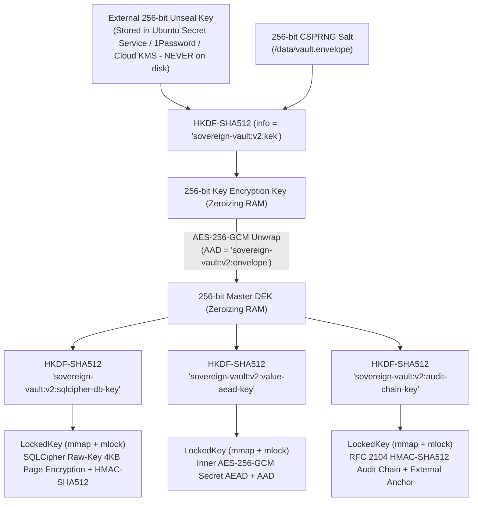

# Sovereign Vault v1.0 - Cryptographic and Runtime Architecture

**Version**: `1.0.0`  
**Architecture Spec**: SPEC-014 (Micro-KMS Architecture), ADR-0008 (Zero-Trust BYOC and Hardware Enclaves)

---

## 1. End-to-End Cryptographic Hierarchy

Sovereign Vault separates **key wrapping**, **database page encryption**, **per-value authenticated encryption**, and **tamper-evident audit chaining** into domain-separated subkeys derived from a single 256-bit Master Data Encryption Key (`master_dek`):

---

## 2. Request Processing and Defense-in-Depth Lifecycle

### 2.1 First-Boot Initialization (`POST /v1/sys/init`)
1. On first boot (no `/data/vault.envelope`), the daemon generates a 256-bit single-use bootstrap nonce (`init_<64hex>`) held in `Zeroizing<String>` RAM and written with `0600` permissions to `/data/.bootstrap_nonce` (never printed to stdout or container log collectors).
2. `init_handler` verifies `X-Vault-Bootstrap-Nonce` in constant time (`constant_time_str_eq`) under a per-IP sliding-window rate limiter (`PeerIp`), immediately burning the in-memory nonce and deleting `/data/.bootstrap_nonce` upon durable initialization.
3. Generates `unseal_key` ($32\text{ B}$) and `master_dek` ($32\text{ B}$), wraps `master_dek` into `/data/vault.envelope` (`0600`), configures `PRAGMA cipher_memory_security = ON;` prior to keying `/data/vault.db` (`0600`) with a raw 256-bit `HKDF-SHA512` SQLCipher key (`PRAGMA key = "x'<64hex>'"`, `HMAC_SHA512`, `PRAGMA synchronous = FULL`), mints the initial root admin token (`SHA-512` hashed at rest), records genesis event `sys.init` in `audit_log` + `/data/vault.audit_anchor` (`0600`), and returns `(unseal_key, admin_token)` once.

### 2.2 Seal, Verified Unseal, and Online KEK Rotation (`POST /v1/sys/seal`, `POST /v1/sys/unseal`, `POST /v1/sys/rotate-unseal-key`)
- **Seal**: Requires `admin` capability, records `sys.seal` fail-closed in the hash-chained `audit_log`, purges the in-memory OIDC JWKS cache, and sets `AppState.active = None`, closing SQLCipher and triggering `Drop` on every `LockedKey` (`zeroize` -> `munlock` -> `munmap`).
- **Unseal**: Rejects with `409 Conflict` if already unsealed. Verifies the `AES-256-GCM` tag on `/data/vault.envelope` **before** opening SQLCipher or mutating runtime state (`401 Unauthorized` + per-IP rate-limit accounting on invalid key).
- **Online Unseal Key Rotation**: `POST /v1/sys/rotate-unseal-key` (admin token + current unseal key) unwraps `master_dek` in `Zeroizing` RAM, generates a fresh 256-bit unseal key and CSPRNG salt/nonce, atomically rewrites `/data/vault.envelope` (`0600` temp + `fsync` + `rename`), and records `sys.rotate_unseal_key` without downtime or secret ciphertext re-encryption.

### 2.3 Dual-Mode Authentication, SSRF-Hardened OIDC, and Canonical ACLs
1. **Machine Tokens**: `authenticate_caller` splits `sv_live_<32hex_id>_<64hex_secret>`, looks up `tok_<32hex_id>` in SQLCipher (performing dummy `SHA-512` constant-time work on unknown IDs to prevent timing enumeration), verifies `SHA-512(secret)` via `subtle::ConstantTimeEq`, and enforces `expires_at` TTLs.
2. **OIDC Workload Identity**: Enforces `https://` issuer/JWKS URLs, blocks cloud metadata (`169.254.169.254`), loopback, and RFC1918 targets by default with DNS resolution pinning and zero HTTP redirects, isolates cached JWKS keys per `binding_id` (evicting immediately on revocation), and enforces RFC 7517 `use == "sig"`, `crv`, `kid` matching, and bounded token lifetimes.
3. **Canonical Path ACLs & Atomic Auditing**: `canonicalize_secret_path` rejects `.`, `..`, `//`, and non-canonical characters (`400 Bad Request`). Mutations (`secret.put`, `secret.delete`, `token.enroll`, `token.revoke`, `oidc.binding.enroll`, `oidc.binding.revoke`) execute inside a single SQLite transaction alongside `audit_log` insertion and update `/data/vault.audit_anchor` (`0600`). Secret reads (`secret.get`) record audit entries fail-closed prior to returning plaintext.

---

## 3. Strict TLS 1.3 and Scale-Out Roadmap

- **Strict TLS 1.3**: By default, the daemon constructs a `rustls::ServerConfig` pinned exclusively to `&rustls::version::TLS13` with a 397-day self-signed ECDSA P-256 certificate (or custom `--tls-cert` / `--tls-key`). TLS 1.2 and older handshakes are rejected.
- **Scale-Out Roadmap**:
  - **Single Node**: SQLCipher WAL mode supports concurrent reads and serialized durable writes; `POST /v1/sys/backup` verifies `PRAGMA wal_checkpoint(TRUNCATE)` (`busy == 0`) and returns a SHA-256 snapshot digest.
  - **Read Scale / HA DR**: Primary-Replica WAL streaming or KMS-wrapped encrypted snapshots to object storage (**never** mount SQLite/SQLCipher over NFS/EFS).
  - **Active-Active Quorum (Tier 3)**: Embedded Raft (`openraft`) state machine consensus + Shamir $M$-of-$N$ unseal quorum.
