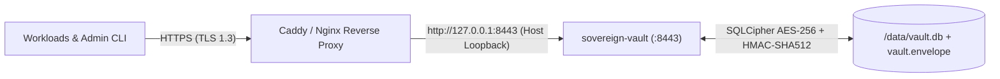

# Sovereign Vault (v0.3)

[](LICENSE)
[](https://oakai-security.com)
[](Cargo.toml)

**Sovereign Vault** is a single-binary, zero-account, containerized **Micro-KMS & Universal OIDC Secret Broker** engineered for developer speed, homelab workload federation, and enterprise BYOC (Bring Your Own Cloud) operations.

Part of the **Oakai Security** (`oakai-security.com`) suite.

---

## v0.3 Cryptographic, OIDC & Operational Guarantees

* **Dual-Mode Authentication (`sv_live_*` + Universal OpenID Connect JWTs)**:
  * Automatically routes 3-part dot-separated JWTs (`header.payload.signature`) to the pure-Rust OIDC & JWKS validator (`ring 0.17`), verifying `RS256`, `RS384`, `RS512`, `ES256`, `ES384`, and `EdDSA` (`Ed25519`) signatures with zero OpenSSL bloat.
  * Preserves constant-time `SHA-512` machine tokens (`sv_live_*` / `sv_admin_*`) as a dual-mode fallback for standalone CLI scripts and legacy workloads.
* **Transparent OIDC Provider Presets & Instant JWKS Cache Refresh**:
  * Built-in provider presets (`github`, `gitlab`, `google`, `azure`, `kubernetes`, `authelia`, `dex`, `custom`) plus inline JWKS JSON support eliminate manual JWKS URL lookup.
  * Automatically refreshes the in-memory JWKS public key cache **every 15 minutes (`900s`)**, **immediately upon binding enrollment/revocation**, and on-demand via `POST /v1/sys/oidc/refresh` (`sovereign-vault oidc refresh`).
* **Enterprise Fleet Metrics & Real-Time SIEM Audit Streaming**:
  * Exposes `GET /v1/sys/metrics` (JSON and `?format=prometheus` exposition format) for Prometheus/Grafana scraping (`sealed`, `mlock_active`, `total_secrets_count`, `active_tokens_count`, `active_oidc_bindings_count`, `jwks_cached_keys_count`, `audit_seq`).
  * Supports non-blocking real-time SIEM webhook streaming (`OAKAI_SIEM_WEBHOOK_URL`) of every RFC 2104 `HMAC-SHA512` hash-chained `AuditLogEntry`.
* **Zero Plaintext Keys on Disk (`HKDF-SHA512` Envelope)**:
  * Initialization generates a random 256-bit Master DEK wrapped with an `HKDF-SHA512` Key Encryption Key (KEK) under `AES-256-GCM` (`aad = "sovereign-vault:v2:envelope"`).
  * `/data/vault.envelope` (`0600`) stores only salt, nonce, and wrapped DEK ciphertext. Unseal verifies the AEAD tag *before* opening storage (`401` on invalid key, `409` if already unsealed).
* **Full-Database Encryption (`SQLCipher` + `HMAC_SHA512`)**:
  * Every 4 KB SQLite page, table schema, secret path index, OIDC trust binding, and WAL frame in `/data/vault.db` is encrypted via 256-bit SQLCipher (`PBKDF2_HMAC_SHA512` / `HMAC_SHA512`, `PRAGMA synchronous = FULL`).
  * Secret values receive a second inner `AES-256-GCM` layer bound to canonical Associated Data (`sv:v2:{project}:{path}:{version}`), preventing row-swapping and preserving immutable version history (`secret_versions`).
* **Canonical Path & Directory-Boundary ACLs**:
  * Rejects `.` / `..` / `//` traversal segments (`400 Bad Request`) and enforces strict trailing-slash boundaries (`apps/jellyfin/*` grants `apps/jellyfin/db_pass` and denies `apps/jellyfin-prod/db_pass` with `403 Forbidden`).
* **Dedicated RAM-Pinned Key Enclave**:
  * `LockedKey` allocates page-aligned anonymous `mmap` memory pinned via `mlock()`, marked `MADV_DONTDUMP`, scrubbed via volatile `zeroize` prior to `munlock`/`munmap`, and guarded globally with `PR_SET_DUMPABLE = 0`.
* **Zero-History CLI (`rpassword` + `--stdin` + `export`)**:
  * No CLI flag accepts raw keys, tokens, or secrets on the command line, eliminating `~/.bash_history` and `ps aux` leakage. Includes `sovereign-vault run` (in-memory child process env injection) and `sovereign-vault export` (`0600` tmpfs `.env` rendering for Kubernetes/Docker init-containers).

---

## Architecture (Reverse-Proxy TLS Pattern)

In production and local deployments, `sovereign-vault` binds strictly to host loopback (`127.0.0.1:8443`). Your edge reverse proxy (Caddy, Nginx, Traefik, or Cloudflare Tunnel) terminates TLS (`https://vault.internal.company.com`) using ACME or corporate PKI certificates and forwards over loopback:



Example `Caddyfile`:
```caddyfile
vault.internal.company.com {
    reverse_proxy 127.0.0.1:8443
}
```

---

## Quickstart & Clean Rebuild Loop

### 1. Destroy, Wipe, Rebuild & Auto-Init into Ubuntu Secret Service
During active development or testing, tear down any existing container, wipe the encrypted volume, rebuild from source, and initialize directly into Ubuntu Secret Service (`gnome-keyring`) with zero shell history:

```bash
./scripts/rebuild_dev_vault.sh --auto-init
```

*(Omit `--auto-init` if you want a clean uninitialized container to test manual `init` steps.)*

### 2. Manual Zero-History Initialization
```bash
# View the single-use first-boot nonce
docker logs sovereign-vault | grep "Nonce:"

# Run interactive hidden-TTY init (pasted nonce will NOT appear in terminal or ~/.bash_history)
docker exec -it sovereign-vault sovereign-vault init
```

### 3. Enroll a Universal OIDC Trust Binding (Preset Mode)
Allow GitHub Actions, Kubernetes ServiceAccounts, or local Dex/Authelia workloads to authenticate using short-lived OIDC JWTs (`Authorization: Bearer <jwt>`) with zero static tokens:
```bash
# Provide the admin token securely via OS keyring (Linux Secret Service / macOS Keychain / Windows Credential Guard):
python3 -m keyring get sovereign-vault admin-token | \
  docker exec -i sovereign-vault sovereign-vault oidc enroll \
    --preset github \
    --project payments \
    --name github-actions-deploy \
    --subject-pattern "repo:acme/payments-service:ref:refs/heads/main" \
    --path "apps/payments/*" \
    --cap read \
    --token-stdin

# Trigger an ad-hoc JWKS cache refresh at any time (in addition to the automatic 15m refresh)
python3 -m keyring get sovereign-vault admin-token | \
  docker exec -i sovereign-vault sovereign-vault oidc refresh --token-stdin
```

### 4. Enroll a Scoped Machine Token (Dual-Mode Fallback)
```bash
python3 -m keyring get sovereign-vault admin-token | \
  docker exec -i sovereign-vault sovereign-vault token enroll \
    --project jellyfin \
    --name jellyfin-prod-01 \
    --path "apps/jellyfin/*" \
    --cap read --cap write \
    --token-stdin
```

### 5. Zero-File Secret Injection (`run`) & Init-Container Tmpfs Rendering (`export`)
Inject secrets directly into a child process in memory (`run`) or render a `0600` `.env` file into an in-memory `tmpfs` volume (`export`) using either an OIDC JWT (`--token-file`) or a machine token:
```bash
# Direct child process injection (zero .env files on disk)
python3 -m keyring get sovereign-vault admin-token | \
  docker exec -i sovereign-vault sovereign-vault run \
    --map DB_PASSWORD=apps/jellyfin/db_pass \
    --token-stdin -- env

# Init-container tmpfs .env export (0600 permissions)
docker exec -i sovereign-vault sovereign-vault export \
  --token-file /var/run/secrets/oidc/jwt \
  --map DB_PASSWORD=apps/jellyfin/db_pass \
  --output /secrets/.env

# Query Prometheus / JSON Fleet Metrics
docker exec sovereign-vault sovereign-vault metrics --prometheus
```

### 5. Online Encrypted Backup & Tamper-Evident Audit Verification
```bash
# Create an atomic 0600 SQLCipher snapshot in /data/backups/
python3 -m keyring get sovereign-vault admin-token | \
  docker exec -i sovereign-vault sovereign-vault backup --token-stdin

# Verify full RFC 2104 HMAC-SHA512 hash-chained audit history
python3 -m keyring get sovereign-vault admin-token | \
  docker exec -i sovereign-vault sovereign-vault audit --limit 50 --token-stdin
```

### 6. Seal & Auto-Unseal Verification
```bash
# Seal vault (drops SQLCipher connection & scrubs mlock'd RAM pages)
python3 -m keyring get sovereign-vault admin-token | \
  docker exec -i sovereign-vault sovereign-vault seal --token-stdin

# Unseal cleanly via stdin pipe from OS keyring
python3 -m keyring get sovereign-vault unseal-key | \
  docker exec -i sovereign-vault sovereign-vault unseal --stdin
```

---

## License

Licensed under the Apache License, Version 2.0. See [LICENSE](LICENSE) for details.
