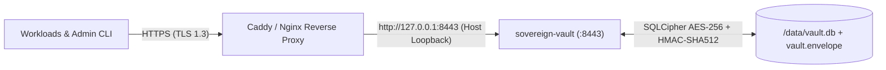

# Sovereign Vault (v0.2)

[](LICENSE)
[](https://oakai-security.com)
[](Cargo.toml)

**Sovereign Vault** is a single-binary, zero-account, containerized **Micro-KMS (Key Management Service)** engineered for developer speed, sovereign edge deployments, and enterprise BYOC (Bring Your Own Cloud) operations.

Part of the **Oakai Security** (`oakai-security.com`) suite.

---

## v0.2 Cryptographic & Operational Guarantees

* **Zero Plaintext Keys on Disk (`HKDF-SHA512` Envelope)**:
  * Initialization generates a random 256-bit Master DEK wrapped with an `HKDF-SHA512` Key Encryption Key (KEK) under `AES-256-GCM` (`aad = "sovereign-vault:v2:envelope"`).
  * `/data/vault.envelope` (`0600`) stores only salt, nonce, and wrapped DEK ciphertext. Unseal verifies the AEAD tag *before* opening storage (`401` on invalid key, `409` if already unsealed).
* **Full-Database Encryption (`SQLCipher` + `HMAC_SHA512`)**:
  * Every 4 KB SQLite page, table schema, secret path index, and WAL frame in `/data/vault.db` is encrypted via 256-bit SQLCipher (`PBKDF2_HMAC_SHA512` / `HMAC_SHA512`, `PRAGMA synchronous = FULL`).
  * Secret values receive a second inner `AES-256-GCM` layer bound to canonical Associated Data (`sv:v2:{project}:{path}:{version}`), preventing row-swapping and preserving immutable version history (`secret_versions`).
* **Post-Quantum-Resilient `SHA-512` Machine Tokens**:
  * Machine tokens (`sv_live_<32hex_id>_<64hex_secret>`) carry 256 bits of CSPRNG entropy, are hashed at rest with `SHA-512`, and are verified in constant time (`subtle::ConstantTimeEq`).
  * Default-deny authentication on every secret and administrative endpoint (`401` when missing/invalid).
* **Canonical Path & Directory-Boundary ACLs**:
  * Rejects `.` / `..` / `//` traversal segments (`400 Bad Request`) and enforces strict trailing-slash boundaries (`apps/jellyfin/*` grants `apps/jellyfin/db_pass` and denies `apps/jellyfin-prod/db_pass` with `403 Forbidden`).
* **Dedicated RAM-Pinned Key Enclave**:
  * `LockedKey` allocates page-aligned anonymous `mmap` memory pinned via `mlock()`, marked `MADV_DONTDUMP`, scrubbed via volatile `zeroize` prior to `munlock`/`munmap`, and guarded globally with `PR_SET_DUMPABLE = 0`.
* **Zero-History CLI (`rpassword` + `--stdin`)**:
  * No CLI flag accepts raw keys, tokens, or secrets on the command line, eliminating `~/.bash_history` and `ps aux` leakage. Pairs natively with Ubuntu Secret Service (`gnome-keyring` / Python `keyring`).
* **100% Air-Gapped Standalone Default**:
  * Standalone containers never initiate outbound connections. Enterprise Fleet heartbeat telemetry activates strictly when **both** `OAKAI_ENTERPRISE_LICENSE` and `OAKAI_TELEMETRY_ENABLED=true` are explicitly configured, reporting only aggregate counts (`total_secrets_count`, `active_tokens_count`, `storage_bytes`).

---

## Architecture (Reverse-Proxy TLS Pattern)

In production and local deployments, `sovereign-vault` binds strictly to host loopback (`127.0.0.1:8443`). Your edge reverse proxy (Caddy, Nginx, Traefik, or Cloudflare Tunnel) terminates TLS (`https://vault.internal.company.com`) using ACME or corporate PKI certificates and forwards over loopback:



Example `Caddyfile`:
```caddyfile
vault.internal.company.com {
    reverse_proxy 127.0.0.1:8443
}
```

---

## Quickstart & Clean Rebuild Loop

### 1. Destroy, Wipe, Rebuild & Auto-Init into Ubuntu Secret Service
During active development or testing, tear down any existing container, wipe the encrypted volume, rebuild from source, and initialize directly into Ubuntu Secret Service (`gnome-keyring`) with zero shell history:

```bash
./scripts/rebuild_dev_vault.sh --auto-init
```

*(Omit `--auto-init` if you want a clean uninitialized container to test manual `init` steps.)*

### 2. Manual Zero-History Initialization
```bash
# View the single-use first-boot nonce
docker logs sovereign-vault | grep "Nonce:"

# Run interactive hidden-TTY init (pasted nonce will NOT appear in terminal or ~/.bash_history)
docker exec -it sovereign-vault sovereign-vault init
```

### 3. Enroll a Scoped Machine Identity
```bash
python3 python3 -m keyring \
  get sovereign-vault admin-token | \
  docker exec -i sovereign-vault sovereign-vault token enroll \
    --project jellyfin \
    --name jellyfin-prod-01 \
    --path "apps/jellyfin/*" \
    --cap read --cap write \
    --token-stdin
```

### 4. Zero-File Secret Injection (`sovereign-vault run`)
Inject secrets directly into a child process in memory without ever writing a `.env` file to disk:
```bash
python3 python3 -m keyring \
  get sovereign-vault admin-token | \
  docker exec -i sovereign-vault sovereign-vault run \
    --map DB_PASSWORD=apps/jellyfin/db_pass \
    --token-stdin -- env
```

### 5. Online Encrypted Backup & Tamper-Evident Audit Verification
```bash
# Create an atomic 0600 SQLCipher snapshot in /data/backups/
python3 python3 -m keyring \
  get sovereign-vault admin-token | \
  docker exec -i sovereign-vault sovereign-vault backup --token-stdin

# Verify full RFC 2104 HMAC-SHA512 hash-chained audit history
python3 python3 -m keyring \
  get sovereign-vault admin-token | \
  docker exec -i sovereign-vault sovereign-vault audit --limit 50 --token-stdin
```

### 6. Seal & Auto-Unseal Verification
```bash
# Seal vault (drops SQLCipher connection & scrubs mlock'd RAM pages)
python3 python3 -m keyring \
  get sovereign-vault admin-token | \
  docker exec -i sovereign-vault sovereign-vault seal --token-stdin

# Unseal cleanly via stdin pipe from Ubuntu Secret Service
python3 python3 -m keyring \
  get sovereign-vault unseal-key | \
  docker exec -i sovereign-vault sovereign-vault unseal --stdin
```

---

## License

Licensed under the Apache License, Version 2.0. See [LICENSE](LICENSE) for details.
