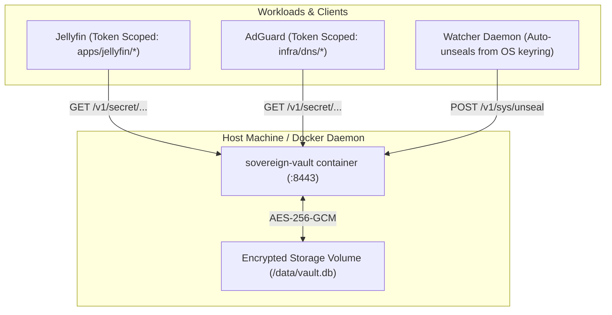

# Sovereign Vault

[](LICENSE)
[](https://oakai-security.com)
[](docs/specs/014-sovereign-micro-kms-vault.md)

**Sovereign Vault** is a lightweight, single-binary, containerized **Micro-KMS (Key Management Service)** engineered for modern homelabs and sovereign edge infrastructure. It gives you the convenience of Caddy with enterprise-grade cryptographic guarantees.

Part of the **Oakai Security** (`oakai-security.com`) suite.

---

## Key Features

* **Zero Accounts / Zero Human Friction**: No user logins, no master passwords, no mandatory multi-tier organization signup wizards.
* **Encrypted Volume Storage**: Single-file SQLite database persisted with authenticated AES-256-GCM AEAD encryption. Disk inspection reveals only opaque high-entropy ciphertext.
* **First-Boot Nonce Guard**: Prevents port-hijacking race conditions by printing an ephemeral 64-character token strictly to container standard output.
* **Memory Protection Enclave**:
  * Pinned heap memory using `mlock()` prevents kernel swap page leaks to disk.
  * Instant hardware-level memory scrubbing using Rust's `zeroize` on drop.
  * `PR_SET_DUMPABLE = 0` blocks debugger attachments (`ptrace`/`gdb`) and core dumps.
* **Path-Scoped Machine Tokens**: Fine-grained project ACLs (e.g. `apps/jellyfin/*`) ensure a compromised microservice cannot read other infrastructure credentials.
* **Automated Unseal Watcher**: Client utility runs on an authorized node, checks health status, and automatically unseals the vault after system reboots using your host's local OS Credential Guard (`keyring`).

---

## Architecture



---

## Quickstart

### 1. Launch with Docker Compose
```bash
docker compose up -d
```

### 2. Retrieve First-Boot Nonce
```bash
docker logs sovereign-vault | grep "Nonce:"
```

### 3. Initialize the Vault
```bash
curl -X POST http://localhost:8443/v1/sys/init \
  -H "X-Vault-Bootstrap-Nonce: <your_nonce_here>"
```
*Save the generated 256-bit unseal key into your personal password manager or OS keyring.*

### 4. Unseal After Reboot
```bash
curl -X POST http://localhost:8443/v1/sys/unseal \
  -H "Content-Type: application/json" \
  -d '{"unseal_key": "<your_unseal_key>"}'
```

---

## License

Licensed under the Apache License, Version 2.0. See [LICENSE](LICENSE) for details.
